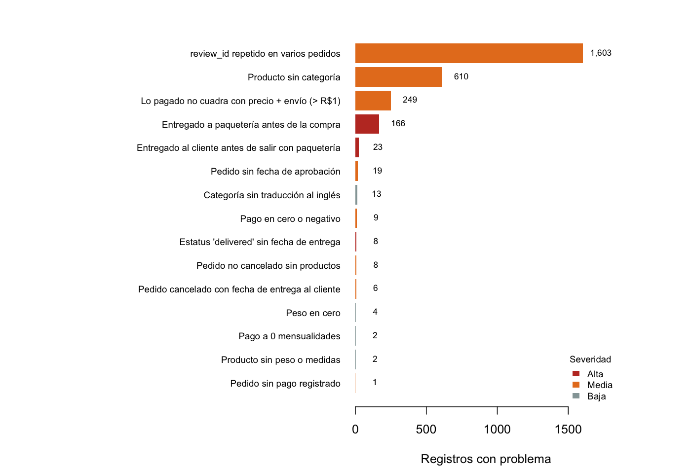

# Validación de calidad e integridad de datos con R

[English](README.md) · **Español**

**Caso de estudio con datos públicos** · R · Rafael Adonay Rocha Gutiérrez

## Escenario

Rol simulado: soporte de datos para el equipo de operaciones de un marketplace. Los usuarios internos reportan incidencias en los tableros de control: información faltante, tiempos de entrega que no tienen sentido y ventas que no aparecen en ninguna categoría. Antes de tocar el tablero, reviso la base desde su origen para responder:

1. ¿Qué tan confiables son los datos que alimentan los tableros?
2. ¿Qué registros tienen problemas y de qué tipo?
3. ¿Cuánto cambian los indicadores si no se corrigen?

## Datos

[Brazilian E-Commerce Public Dataset by Olist](https://www.kaggle.com/datasets/olistbr/brazilian-ecommerce) (Kaggle): 8 tablas relacionadas con **550,759 registros** (99,441 pedidos de 2016 a 2018, artículos, pagos, reseñas, clientes, productos, vendedores y traducción de categorías).

Herramientas: R 4.6 (solo R base, sin paquetes).

## Método: 32 reglas de calidad en 7 categorías

| Categoría | Qué revisa | Ejemplo de regla |
|---|---|---|
| Completitud | Datos faltantes donde no deberían faltar | Producto sin categoría |
| Unicidad | Llaves duplicadas | `order_id` duplicado |
| Integridad | Registros que apuntan a algo que no existe | Artículo con un producto inexistente |
| Fechas | Fechas fuera de orden | Entregado al cliente antes de salir con la paquetería |
| Estatus | Estatus que no coincide con las fechas | Estatus `delivered` sin fecha de entrega |
| Rangos | Valores imposibles | Pago en cero, calificación fuera de 1 a 5 |
| Cuadre | Totales que no cuadran | Lo pagado ≠ precio + envío |

Cada regla deja registrados los IDs que fallan, para poder corregirlos uno por uno.

## Hallazgos clave

**17 de las 32 reglas pasan:** no hay llaves duplicadas, todas las relaciones entre tablas son válidas y todas las calificaciones están entre 1 y 5. **15 reglas encuentran problemas:**

| # | Problema | Registros | Qué pasa en un tablero |
|---|---|---|---|
| 1 | El mismo `review_id` aparece en 2 o más pedidos | 1,603 renglones | Contar reseñas por ID da 98,410 en lugar de 99,224 |
| 2 | Producto sin categoría | 610 productos | **R$179,535 en ventas (1.32%)** aparecen "en blanco" en ventas por categoría |
| 3 | Lo pagado no cuadra con precio + envío (diferencia mayor a R$1) | 249 pedidos | Ingresos distintos según la tabla que use el tablero |
| 4 | Entregado a la paquetería **antes** de la compra | 166 pedidos | Error en fechas: tiempos de preparación negativos |
| 5 | Entregado al cliente **antes** de salir con la paquetería | 23 pedidos | Tiempos de transporte negativos que bajan el promedio |
| 6 | Pedido no cancelado sin fecha de aprobación | 19 pedidos | Información faltante en el tiempo de aprobación |
| 7 | Pagos en cero | 9 pagos | Ticket promedio más bajo |
| 8 | Estatus `delivered` sin fecha de entrega | 8 pedidos | Pedidos "entregados" que no aparecen en tiempos de entrega |
| 9 | Pedido no cancelado sin productos | 8 pedidos | Pedidos sin ventas |
| 10 | Pedido cancelado con fecha de entrega al cliente | 6 pedidos | Entregas contadas en un pedido cancelado |

El detalle de las 15 reglas está en [`resultados/reglas.csv`](resultados/reglas.csv), y los 2,723 registros con problema, con su ID, en [`resultados/registros_con_problemas.csv`](resultados/registros_con_problemas.csv).

### ¿Cuánto cambia un indicador?

| Indicador | Datos crudos | Datos validados |
|---|---|---|
| % de entregas tarde | 8.11% (96,478 pedidos) | 8.13% (96,282 pedidos) |

El **% de entregas tarde es confiable**: cambia solo 0.02 puntos. Los problemas pesan más en **tiempos por etapa** (23 tiempos de transporte negativos y 166 de preparación) y en **ventas por categoría** (1.32% sin categoría). Por eso conviene validar cada indicador por separado y no dar por buena toda la base.

## Recomendaciones

1. **Corregir en origen** las 189 fechas fuera de orden (166 + 23) y los 8 pedidos entregados sin fecha. Mientras tanto, el tablero de tiempos debe excluirlos y avisarlo en una nota.
2. **Asignar categoría** a los 610 productos sin categoría, empezando por los que más venden.
3. **Usar `review_id` + `order_id` como llave** de reseñas, no solo `review_id`.
4. **Definir una sola fuente de ingresos** (pagos o artículos) y revisar los 249 pedidos que no cuadran.
5. **Correr este script antes de cada actualización** del tablero, para detectar incidencias antes que los usuarios.

## Archivos

| Archivo | Contenido |
|---|---|
| [`validacion.R`](validacion.R) | Script completo: carga, 32 reglas, resultados, gráfica e impacto en indicadores |
| [`resultados/reglas.csv`](resultados/reglas.csv) | Las 32 reglas con registros revisados, con problema, % y severidad |
| [`resultados/registros_con_problemas.csv`](resultados/registros_con_problemas.csv) | Cada registro con problema y la regla que no cumple |
| [`resultados/impacto_tablero.csv`](resultados/impacto_tablero.csv) | % de entregas tarde con datos crudos y validados |
| [`resultados/salida_consola.txt`](resultados/salida_consola.txt) | Salida completa de la última ejecución |
| [`figuras/problemas_por_regla.png`](figuras/problemas_por_regla.png) | Gráfica de registros con problema por regla |

## Cómo correrlo

1. Descarga el dataset de [Kaggle](https://www.kaggle.com/datasets/olistbr/brazilian-ecommerce) y pon los 8 CSV (sin cambiarles el nombre) en la carpeta `datos/`. Usa los archivos `olist_*_dataset.csv` y `product_category_name_translation.csv`.
2. Desde la carpeta del proyecto: `Rscript validacion.R`

## Proyectos relacionados

- [olist-sql](https://github.com/rafaeladonay7-design/olist-sql): diagnóstico logístico de la misma base con SQL.
- [Portafolio](https://rafaeladonay7-design.github.io)
